<div align="center">

<br>

<picture>
  <source media="(prefers-color-scheme: dark)" srcset="site/public/brand/logo-animated-on-dark.svg">
  
</picture>

<h3>Your pal for every moment.</h3>

<p><b>pal</b> lives in your iMessage and WhatsApp: it tells you what needs you, replies in your voice and holds anything risky for your yes.<br>
<b>PAL Runtime</b> is the open-source layer it runs on, for the agents you build: they finish, stay contained, and stay yours.</p>

<p>
<a href="https://github.com/dshakes/pal/actions/workflows/sdlc-e2e.yml"></a>
<a href="https://github.com/dshakes/pal/actions/workflows/build-images.yml"></a>
<a href="https://github.com/dshakes/pal/actions/workflows/deploy-docs.yml"></a>
<a href="LICENSE"></a>
</p>

<a href="https://dshakes.github.io/pal/"><b>Website</b></a> &nbsp;·&nbsp; <a href="https://dshakes.github.io/pal/docs/"><b>Docs</b></a> &nbsp;·&nbsp; <a href="#try-it-in-60-seconds"><b>Try it in 60 seconds</b></a>

<br><br>

</div>



## pal

A personal agent on your own Mac, in the chats you already use. It knows your people, your calendar and your mail, and it never says yes on your behalf.

- **Brief.** Type `?` and get what needs you across every thread, ranked with a reason. React to act: 👍 do it, 👎 skip, ⏰ snooze.
- **Holds.** Money, commitments and claims it can't verify are held at the send boundary, with an always-on backstop that works even when the model doesn't.
- **Sounds like you.** Every draft is scored against messages you really sent; a draft that drifts from your voice is rewritten before it goes out.
- **Remembers your people.** One memory per person across iMessage and WhatsApp.
- **Knows what's true now.** A dated picture of your life from mail, calendar and your own notes, with a source on every line, and nudges before you'd remember.

<table>
<tr>
<td width="50%"></td>
<td width="50%"></td>
</tr>
<tr>
<td width="50%"></td>
<td width="50%"></td>
</tr>
</table>

## PAL Runtime

The layer pal runs on, open source, for your own agents. Durable runs, microVM sandboxes, hard budgets and signed receipts, with the data plane in your cloud.



- **Agents that finish.** Every step is journaled; after a crash the run resumes where it stopped and finished steps are never re-run. External side effects carry an idempotency key.
- **Contained.** Untrusted code runs in a Firecracker or Kata microVM that you can pause, resume with the same id, or fork into many that share memory.
- **Nothing leaks.** In broker mode the VM has no network device: a host broker enforces the allowlist, injects credentials the guest never sees, and scans for card numbers and keys.
- **Proof.** Each run can carry an Ed25519 receipt over the hash of its journal. Edit one row and it fails to verify.
- **Spend you set.** Budgets refuse a run with HTTP 402 before the model is called. Ask for a capability, not a vendor. A regressed eval returns 422 and blocks the deploy.

<table>
<tr>
<td width="50%"></td>
<td width="50%"></td>
</tr>
<tr>
<td width="50%"></td>
<td width="50%"></td>
</tr>
</table>

## Try it in 60 seconds

Docker only, no API key. `make demo` starts the control plane, the console and a recorded-answer model server (it also needs `openssl`). Each visitor gets a private workspace, deleted after 30 minutes; nothing calls a model provider.

```bash
git clone https://github.com/dshakes/pal.git && cd pal
make demo         # prints "demo: http://localhost:3001/kiosk"
make demo-down    # stop and delete all demo data
```

## Run your own agent

Needs Docker, Go 1.25+ for the CLI, and an OpenAI or Anthropic key.

```bash
make dev                                         # Postgres, Redis, MinIO, control plane, console
( cd packages/cli && go install ./cmd/pal )  # the CLI
pal doctor                                   # health, auth, model provider, a live run
pal onboard                                  # describe an agent in one line, get a running agent
```

Console: http://localhost:3001, sign in as `admin@pal.local` / `pal` (local dev only). Sandboxes, the egress broker and real Firecracker on a Mac: [Runtime quickstart](https://dshakes.github.io/pal/docs/runtime/quickstart/).

## Use it from code

The SDKs are not on a registry yet; install from a checkout (`npm install /path/to/pal/packages/sdk-ts`, or `pip install /path/to/pal/packages/sdk-python`).

```ts
import { PalClient } from "@pal/sdk";

const pal = new PalClient({ baseUrl: "http://localhost:8080", apiKey: process.env.PAL_API_KEY });

await pal.agents.create({ name: "triage", description: "Classifies support emails" });
await pal.budgets.upsert("triage", { maxCostUsdPerDay: 25, hardFail: true });
const run = await pal.runs.create({ agent: "triage", input: { email: "..." } }); // 402 if over the daily cap
```

Pass `baseUrl` (or set `PAL_API_URL`): the client's default is not your self-hosted stack. Python and Go SDKs cover the same management surface.

## What's in the repo

| | |
|---|---|
| Control plane, workflow engine, schedulers | Go |
| Model router, runtime manager, in-VM harness, gateways | Rust |
| Console, website, TypeScript SDK | TypeScript |
| SDKs | TypeScript, Python, Go |
| pal's bridges (iMessage, WhatsApp) | TypeScript, on your own Mac |

## Learn more

- Website and docs: [dshakes.github.io/pal](https://dshakes.github.io/pal/) (source in [`site/`](site/))
- Architecture and decisions: [`docs/architecture/`](docs/architecture/), [`docs/adr/`](docs/adr/)
- Brand, logo files and the diagram sources: [`docs/brand/`](docs/brand/)
- Conventions and invariants: [`CLAUDE.md`](CLAUDE.md)
- Contributing: [`CONTRIBUTING.md`](CONTRIBUTING.md). Run `make ci-local` before pushing.

---

<sub>We started as PAL: a flame you could carry because glass kept it contained. As the product became a companion, we kept the light and dropped the lamp. The flame became a dot, a single moment of attention. पल means "a moment." A pal is someone who shows up in it.</sub>
