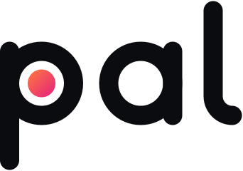
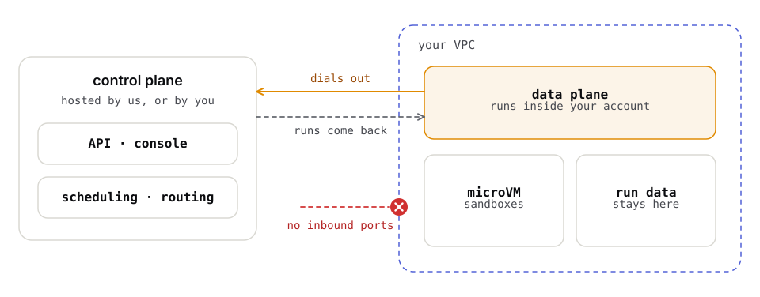

<div align="center">

<picture>
  <source media="(prefers-color-scheme: dark)" srcset="site/public/brand/lockup-on-dark.svg">
  
</picture>

### The Personal Agentic Layer

**pal** is a personal agent that replies in your voice, remembers your people and asks before it promises anything.
**PAL Runtime** is the open-source layer it runs on, for the agents you build: durable runs, microVM sandboxes, hard budgets and signed receipts, in your own cloud.

[Website](https://dshakes.github.io/lantern/) · [Docs](https://dshakes.github.io/lantern/docs/) · [Compare](https://dshakes.github.io/lantern/compare/) · [Apache-2.0](LICENSE)

</div>

> The CLI and packages are still named `lantern` while the rename lands. Commands, env vars (`LANTERN_*`) and package names below are the real ones today.

<picture>
  <source media="(prefers-color-scheme: dark)" srcset="site/public/diagrams/your-cloud-dark.svg">
  
</picture>

## The PAL Promise

- **Sounds like you.** Every reply is scored against messages you really sent; a draft that drifts from your voice is rewritten before it goes out.
- **Remembers your people.** One memory of each person across iMessage and WhatsApp.
- **Asks before it promises.** Money, commitments and claims it cannot verify are held for your yes, enforced at the send boundary, not in a prompt.
- **Never stops, never leaks.** Runs resume from their journal after a crash, untrusted code runs in a Firecracker or Kata microVM, credentials can stay on the host (opt-in broker mode), budgets return HTTP 402 before the model is called, and every run can carry a signed receipt.

pal runs on PAL Runtime: the layer that runs your life can run your agents.

## Try it in 60 seconds

Docker only, no API key. `make demo` starts the control plane, the console and a recorded-answer model server (it also needs `openssl`). Each visitor gets a private workspace, deleted after 30 minutes; nothing calls a model provider.

```bash
git clone https://github.com/dshakes/lantern.git && cd lantern
make demo         # prints "demo: http://localhost:3001/kiosk"
make demo-down    # stop and delete all demo data
```

## Run your own agent

Needs Docker, Go 1.25+ for the CLI, and an OpenAI or Anthropic key.

```bash
make dev                                         # full stack: Postgres, Redis, MinIO, control plane, console
( cd packages/cli && go install ./cmd/lantern )  # the `lantern` CLI
lantern doctor                                   # health, auth, model provider, a live run
lantern onboard                                  # describe an agent in one line, get a running agent
```

Console: http://localhost:3001, sign in as `admin@lantern.dev` / `lantern` (local dev only). Sandboxes, the egress broker and real Firecracker on a Mac: see the [Runtime quickstart](https://dshakes.github.io/lantern/docs/runtime/quickstart/).

## Use it from code

The SDKs are not on a registry yet; install from a checkout (`npm install /path/to/lantern/packages/sdk-ts`, or `pip install /path/to/lantern/packages/sdk-python`).

```ts
import { LanternClient } from "@lantern/sdk";

const lantern = new LanternClient({ baseUrl: "http://localhost:8080", apiKey: process.env.PAL_API_KEY });

await lantern.agents.create({ name: "triage", description: "Classifies support emails" });
await lantern.budgets.upsert("triage", { maxCostUsdPerDay: 25, hardFail: true });
const run = await lantern.runs.create({ agent: "triage", input: { email: "..." } }); // 402 if over the daily cap
```

Pass `baseUrl` (or set `PAL_API_URL`): the client's default is not your self-hosted stack. Python and Go SDKs cover the same management surface.

## What is in this repo

| | |
|---|---|
| Control plane, workflow engine, schedulers | Go |
| Model router, runtime manager, in-VM harness, gateways | Rust |
| Console, website, TypeScript SDK | TypeScript |
| SDKs | TypeScript, Python, Go |
| Personal agent bridges (iMessage, WhatsApp) | TypeScript, runs on your own Mac |

How PAL Runtime compares with Google Agent Compute Engine, E2B and Modal, honestly and column by column: [/compare](https://dshakes.github.io/lantern/compare/).

## Links

- Website: [dshakes.github.io/lantern](https://dshakes.github.io/lantern/) (source in [`site/`](site/), `cd site && npm run dev`)
- Docs: [dshakes.github.io/lantern/docs](https://dshakes.github.io/lantern/docs/)
- Architecture and decisions: [`docs/architecture/`](docs/architecture/), [`docs/adr/`](docs/adr/)
- Conventions and invariants: [`CLAUDE.md`](CLAUDE.md)
- Contributing: [`CONTRIBUTING.md`](CONTRIBUTING.md). Run `make ci-local` before pushing.
- License: [Apache-2.0](LICENSE)

---

<sub>We started as Lantern: a flame you could carry because glass kept it contained. As the product became a companion, we kept the light and dropped the lamp. The flame became a dot, a single moment of attention. पल means "a moment." A pal is someone who shows up in it.</sub>
