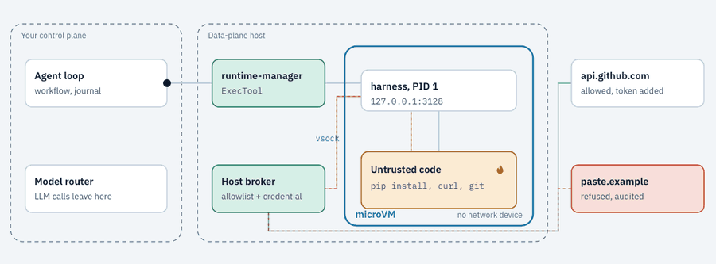
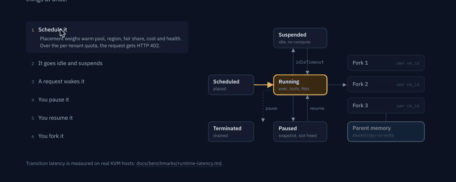

<div align="center">

# Lantern

**Run AI agents in your own cloud. Their code runs in a microVM. Their spend stops at a 402.**
The agent loop stays on your control plane. Code the agent writes runs in a Firecracker or Kata microVM. Every step is journaled, so a crash resumes instead of restarting. Apache-2.0.

[](LICENSE)
[](https://go.dev)
[](https://www.rust-lang.org)
[](https://www.typescriptlang.org)
[](https://dshakes.github.io/lantern/)

<picture>
  <source media="(prefers-color-scheme: dark)" srcset="docs/media/hero-flow-dark.gif">
  
</picture>

</div>

## Why Lantern

- **The agent is outside the sandbox. The code is inside.** Code an agent writes or downloads runs in a Firecracker or Kata microVM, never a bare pod. The loop that holds the prompt and the model keys runs on the control plane, so a compromised workload has nothing to steal and nothing to steer.
- **Credentials stay on the host (broker mode).** Set `LANTERN_EGRESS_MODE=broker` (opt-in, Firecracker only) and the VM boots with no network device. Egress crosses vsock to a broker on the host that checks the allowlist and injects the credential from a `lantern.secret/...` ref. The default mode routes egress through an in-guest CONNECT proxy; enforcement needs the image's iptables REDIRECT rule, and production refuses to boot without it when egress is declared.
- **Idle sandboxes give their compute back; forks share memory.** Set `idleTimeoutSecs` and an idle VM is snapshotted and stopped, then resumed on the next request. Forks hard-link one read-only memory file and copy on write: on a real KVM run, three forks shared one inode and each spawned in 131–160 ms ([Lima nested-virt, indicative](docs/benchmarks/runtime-latency.md)).
- **The rest of production is already here.** Crash-resume from the step journal. Budgets that return HTTP 402 before the run, not after the bill. Models addressed by capability. Eval suites that fail CI with HTTP 422. Signed run receipts (Ed25519 when `LANTERN_RECEIPT_ED25519_SEED` is set) that anyone can verify against the published key. All of it self-hosted in your VPC.

## Quickstart

You need Docker. Go 1.25+ builds the CLI.

```bash
git clone https://github.com/dshakes/lantern.git && cd lantern
make dev                                         # Postgres, Redis, MinIO, control plane, dashboard
( cd packages/cli && go install ./cmd/lantern )  # the `lantern` CLI
lantern doctor                                   # health, auth, LLM provider, a live run
lantern onboard                                  # describe an agent in one line, get a running agent
```

Dashboard: **http://localhost:3001**, sign in as `admin@lantern.dev` / `lantern` (local dev only).

Run code in a sandbox. This uses host processes instead of `make dev` (both bind `:8080`), one per terminal:

```bash
make dev-infra             # Postgres, Redis, MinIO
make run-runtime-manager   # :50054, Docker backend on macOS
make run-scheduler         # :50055
make run-api-runtime       # control plane on :8080, wired to the scheduler
lantern run examples/headless-agents/01-hello/agent.yaml --input '{"name":"world"}'
lantern vm exec <vm-id> -- ls /workspace
lantern vm ls <vm-id>
```

The demo spec pins a placeholder `image_digest`: build the image from `examples/headless-agents/01-hello/` and point the spec at it first, or the VM fails on image pull. Firecracker needs Linux with `/dev/kvm`. On Apple Silicon (M3+, macOS 15+), [`infra/lima/`](infra/lima/) provisions a guest with nested KVM. `make lima-up && make lima-e2e` boots real Firecracker microVMs there in one command each. Full walkthrough: [`docs/guides/headless-agent-quickstart.md`](docs/guides/headless-agent-quickstart.md).

<details>
<summary>Other ways to run the stack</summary>

```bash
lantern dev                 # hot-reload: infra in Docker, API + dashboard + bridges on the host
lantern dev --infra-only    # just Postgres + Redis + MinIO
make dev-infra              # à la carte: then make run-api, make dashboard-dev
make run-api-free           # route LLM calls through your local `claude` CLI at $0 in dev
```

Prerequisites for host processes: Go 1.26+ (the CLI alone builds with 1.25), Node 20+, Rust 1.85+, Docker with Compose v2. `make proto` additionally needs `protoc`. Dev credentials are listed in [`CLAUDE.md`](CLAUDE.md#dev-credentials).

</details>

## How it works


The control plane (Go) owns the agent: the workflow interpreter, the durable journal, the model router and the budget gate. When a durable `tool_call` step needs to run code, the workflow engine calls `ExecTool` on the runtime-manager (Rust) on a data-plane host, which runs it inside a microVM whose PID 1 is the Lantern harness. The VM gets the workload and nothing else: no model keys, no service tokens. In broker mode (`LANTERN_EGRESS_MODE=broker`, opt-in, Firecracker only) the VM has no network device either — all egress crosses vsock to a broker on the host.

### Egress: the VM asks, the host decides


In broker mode (`LANTERN_EGRESS_MODE=broker`, opt-in, Firecracker only): a workload talks to `127.0.0.1:3128` as if it were a normal proxy. The harness forwards the request over vsock to a broker in the runtime-manager on the host. The broker checks the per-sandbox allowlist, adds the credential resolved from the `lantern.secret/...` ref, and sends it upstream. Denied requests are refused and written to the audit stream. In the default mode the allowlist is enforced in-guest; the credential injection moves to the host only when broker mode is enabled.


### Lifecycle: idle auto-suspend




| Transition | Trigger | What happens |
|---|---|---|
| schedule → running | `POST /v1/runtime/schedule`, `lantern run` | Placement by warm pool, region, fair share, cost and health; per-tenant quota (402 over cap) |
| running → suspended | no activity for `idleTimeoutSecs` seconds (0/unset = never) | Snapshot to storage, compute and quota slot released; the scheduler sweeps every 10 s on activity reported with the 30 s node heartbeat, so suspension can trail the timeout by up to ~40 s |
| suspended → running | next `exec` or file request (REST, CLI or SDK) | Resumed transparently; the first exec after restore waits for the in-guest exec channel to reconnect (~4 s in the Lima benchmark) |
| running → paused → running | `lantern vm pause` / `resume` | Snapshot frees the quota slot; resume restores the same `vm_id` |
| running → forked | `lantern vm fork <id> --count N` | Children share the parent's memory copy-on-write, each with its own `vm_id`, cert and identity; N up to 100 by default, 1000 max (`LANTERN_MAX_FORK_COUNT`, enforced by the server) |


Lifecycle latency numbers are in [`docs/benchmarks/runtime-latency.md`](docs/benchmarks/runtime-latency.md) (Lima nested-virt on Apple M4 Max, aarch64 — indicative, not bare metal).

### Trust boundaries


Each hop is authenticated: JWT or scoped API key at the edge; a shared service token (`x-lantern-service-token`) on every internal gRPC port; per-VM certificates that the manager refuses on its own control methods ([ADR 0025](docs/adr/0025-sandbox-spawn-contract-and-manager-authz.md)); row-level security on every tenant table ([ADR 0011](docs/adr/0011-rls-all-tenant-tables.md)). Inside the VM the workload runs as an unprivileged uid with `LANTERN_*` env withheld.

## Capabilities

**Runtime and isolation**
- Firecracker and Kata microVMs, gVisor and runc tiers chosen per workload by isolation class; fail-closed, never downgraded to a bare pod ([ADR 0002](docs/adr/0002-runtime-class-per-workload.md), [0009](docs/adr/0009-kubernetes-default-runtime-substrate.md))
- Two tiers, one journal: trusted runs inline, untrusted runs in the microVM tier ([ADR 0022](docs/adr/0022-two-tier-agent-runtime.md))
- Streaming exec (`text/event-stream`), sandbox file API under `/workspace` (list, read, write), session-scoped VMs
- Pause, resume and fork; idle auto-suspend (`idleTimeoutSecs`) with transparent resume; operator-paused VMs are never auto-resumed
- Host egress broker over vsock (opt-in, `LANTERN_EGRESS_MODE=broker`, Firecracker only); default mode routes egress through an in-guest proxy (enforced when the image installs the iptables REDIRECT rule)

**Agent platform**
- Workflow graphs from the visual editor execute: `trigger`, `ai-step`, `connector`, `condition`, `loop`, `approval`, `subagent`, `end` (`tool` nodes are accepted but return `skipped` until the tool runtime is wired into the control plane)
- Sessions with SSE streaming, cron schedules with time zones, human takeover on approval nodes
- 17 connectors that call the real APIs (OAuth or API key), MCP server registry, A2A agent cards, a forkable agent marketplace
- SDKs: TypeScript (primary), Python, Go; the `lantern` CLI; an embeddable webchat (`/widget.js`)

**Reliability and cost**
- Durable steps with crash-resume from the journal; idempotency keys from `(run_id, step_id, attempt)` on LLM calls and external deliveries, so a replay does not double-send
- Models addressed by capability (`auto`, `reasoning-large`), routed across providers with failover and caching
- Per-agent caps on cost/day and runs/day plus a tenant-wide daily cost cap: over a hard cap the call gets HTTP 402 before the model is called. The per-run cap is checked by the pre-run forecast (`/v1/runs/forecast`); tokens/day and per-tool limits are stored, not enforced yet
- Eval suites with per-branch baselines that fail CI with HTTP 422; rehearsals replay past failures; A/B experiments with auto-promotion

**Security and governance**
- Multi-tenant by default: `tenant_id` on every row and gRPC call, RLS on every tenant table, staged enforcement via `LANTERN_RLS_ENFORCE`
- Signed run receipts over the journal hash: Ed25519 when `LANTERN_RECEIPT_ED25519_SEED` is set (verifiable offline against the key at `/.well-known/lantern-receipts`), HMAC-SHA256 dev fallback otherwise
- Per-instance Ed25519 agent identity, per-VM certificates, scoped API keys, AES-256-GCM credentials at rest
- OpenTelemetry: control-plane and step spans carry `tenant_id`, `run_id`, `step_id`; trace context propagates through scheduler and manager into the harness
- Confidential compute v1: launch measurement recorded, not yet verified ([ADR 0023](docs/adr/0023-confidential-compute.md))

**Personal surfaces**
- WhatsApp and iMessage assistants that reply in the owner's voice, behind commitment and grounding gates that hold money promises and unverifiable claims for the owner
- Slack, Telegram, Discord, voice (Twilio, LiveKit), email and webchat surfaces
- Setup: [`docs/personal/BOT-SETUP.md`](docs/personal/BOT-SETUP.md)

## How Lantern compares

Google's Agent Compute Engine (announced October 22, 2026) and E2B and Modal are
**managed sandboxes**: compute you rent to run agent code. Lantern is an
**open-source agent runtime you host yourself**; its microVM sandbox is one part,
next to durable runs, budgets, routing, evals and receipts. So the honest
comparison has two halves.

**The sandbox.** This is ACE's whole product, and on isolation it is ahead of
Lantern by default: its sandbox never holds a credential and all egress leaves
through a proxy on the host, backed by Google's hardware root of trust. Lantern
can do the same, but only in its opt-in broker mode on Firecracker, and has been
validated on nested KVM, not at Google's scale.

| The sandbox | **Lantern** | Google ACE | E2B | Modal |
|---|---|---|---|---|
| Hardware-isolated microVM per sandbox | ✅ Firecracker / Kata | ✅ | ✅ | partial (gVisor) |
| Agent loop runs outside the sandbox | ✅ | ✅ | partial (you host the loop) | partial (you host the loop) |
| Credentials never enter the sandbox | partial (broker mode, opt-in) | ✅ by default | ❌ | ❌ |
| Egress allowlist enforced outside the guest | partial (broker mode, opt-in) | ✅ by default | partial | partial (IP/CIDR) |
| Idle auto-suspend, resume on demand | ✅ | ✅ | partial | partial |
| Snapshot and fork | ✅ (shared-memory fork) | ✅ | partial | partial |
| Hardware root of trust / attestation | partial (measurement recorded, not verified) | ✅ (Titan) | ❌ | ❌ |
| Proven at scale | Lima nested-KVM + CI only | the infrastructure behind Gemini's agents (per Google) | production | production |

**The platform around it.** These are agent-runtime features. ACE is a compute
layer, so "out of scope" means it isn't trying to do them, not that it fails at
them; on Google Cloud they come from other products.

| The platform | **Lantern** | Google ACE | E2B | Modal |
|---|---|---|---|---|
| Durable agent runs with crash-resume | ✅ | out of scope | ❌ | ❌ |
| Budgets that return HTTP 402 before the model call | partial (cost/day, runs/day, tenant daily cost; tokens and per-tool limits stored, not enforced) | out of scope | ❌ | partial |
| Multi-provider model routing with failover | ✅ | out of scope | ❌ | ❌ |
| Signed, offline-verifiable run receipts | partial (Ed25519 with a configured seed) | out of scope | ❌ | ❌ |
| Self-host in your VPC or on-prem | ✅ Apache-2.0 | ❌ Google Cloud only | partial | ❌ |
| Availability | open source today | preview "in the coming months" | GA | GA |

**When to pick which.** Pick ACE if you want a managed sandbox on Google Cloud
with the strongest isolation defaults. Pick E2B or Modal if you want hosted
sandboxes today. Pick Lantern if you need to run agents in your own cloud or
on-prem, with the sandbox, durable execution, spend limits and audit trail in
one stack you control.

Competitor columns reflect each vendor's public docs and announcements as of
October 2026; the Google column follows Google's [Agent Compute Engine deep
dive](https://cloud.google.com/blog/topics/ai-infrastructure/agent-compute-engine-deep-dive)
(Oct 22, 2026). ❌ means not offered or not announced. Open an issue if a cell is
out of date.

## Use it from code

```ts
import { LanternClient } from "@lantern/sdk";

const lantern = new LanternClient({ baseUrl: "http://localhost:8080", apiKey: process.env.LANTERN_API_KEY });

await lantern.agents.create({ name: "triage", description: "Classifies support emails" });
await lantern.budgets.upsert("triage", { maxCostUsdPerDay: 25, maxCostUsdPerRun: 0.1, hardFail: true });

const forecast = await lantern.runs.forecast({ agentName: "triage", input: "my invoice is wrong again" });
const run = await lantern.runs.create({ agent: "triage", input: { email: "..." } });  // 402 if over budget
```

Python: `client.runtime.{pause,resume,fork,exec_stream,list_files,read_file,write_file}`. Go: `PauseVM`, `ResumeVM`, `ForkVM`, `ListFiles`, `ReadFile`, `WriteFile`.

## Documentation

| Start here | |
|---|---|
| Docs site | [dshakes.github.io/lantern](https://dshakes.github.io/lantern/) (`make docs-dev` serves it on `:3002`) |
| Agent runtime: tiers, durability, observability | [`docs/architecture/09-agent-runtime.md`](docs/architecture/09-agent-runtime.md) |
| Headless quickstart and demo agents | [`docs/guides/headless-agent-quickstart.md`](docs/guides/headless-agent-quickstart.md), [`examples/headless-agents/`](examples/headless-agents/) |
| Isolation classes, identity and secrets | [`docs/guides/isolation-classes.md`](docs/guides/isolation-classes.md), [`docs/guides/identity-and-secrets.md`](docs/guides/identity-and-secrets.md) |
| Develop locally, ship to your cloud | [`docs/guides/local-to-prod.md`](docs/guides/local-to-prod.md), [`docs/guides/self-service-e2e.md`](docs/guides/self-service-e2e.md) |
| Architecture and decisions | [`docs/architecture/`](docs/architecture/), [`docs/adr/`](docs/adr/) |
| Operating it: runbooks, alerts, dashboards | [`docs/runbooks/`](docs/runbooks/), [`infra/monitoring/`](infra/monitoring/) |
| Brand, tokens and diagram system | [`docs/brand/`](docs/brand/) |
| Conventions and invariants | [`CLAUDE.md`](CLAUDE.md) |

<details>
<summary>Architecture invariants</summary>

1. The control plane never touches user code; only the runtime-manager and harness do.
2. The workflow engine is the only writer of run state.
3. Anything longer than 100ms or calling an LLM is a durable, idempotent, replayable step.
4. Token streams are end to end, with no buffering points.
5. Untrusted code runs in a microVM, never a bare pod.
6. Models are addressed by capability, never by vendor name.
7. Every row and every gRPC call carries `tenant_id`; no cross-tenant joins.
8. Every external side effect carries an idempotency key from `(run_id, step_id, attempt)`.
9. Every service emits OpenTelemetry traces.
10. Secrets never appear in logs, traces or run state.

</details>

<details>
<summary>Services and ports</summary>

| Service | Language | Port | Role |
|---|---|---|---|
| control-plane | Go | `:8080` REST/SSE, `:50051` gRPC | agents, runs, sessions, budgets, evals, receipts |
| workflow-engine | Go | `:50052` | durable step execution, the only writer of run state |
| model-router | Rust | `:50053` | capability routing, failover, caching |
| runtime-manager | Rust | `:50054` | Firecracker, Kata, K8s, Docker, Wasmtime backends |
| runtime-scheduler | Go | `:50055` gRPC, `:8085` REST | placement and quota |
| harness | Rust | in VM | PID 1: egress, identity, audit stream |
| gateway / surface-gateway | Rust | `:8443` / `:8444` | API edge, channel webhooks |
| dashboard / landing / docs | TypeScript | `:3001` / `:3000` / `:3002` | Next.js apps |

</details>

<details>
<summary>Testing</summary>

```bash
make test       # Go (-race), Rust, TypeScript, Python
make test-db    # Go tests that need Postgres
make test-e2e   # live-stack suites against :8080, skip when the stack is down
make lint       # golangci-lint, clippy, tsc/eslint
make ci-local   # lint + test + audit, the CI gate
```

</details>

## Contributing

Read [`CLAUDE.md`](CLAUDE.md) for conventions and invariants, and the relevant [ADR](docs/adr/) before changing a load-bearing decision. Run `make proto` after editing a `.proto` and `make ci-local` before pushing.

## License

[Apache 2.0](LICENSE). Everything described here is in this repository.
