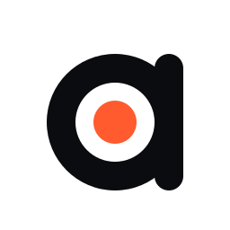
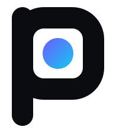
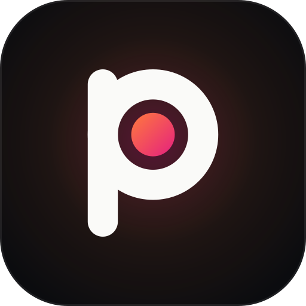
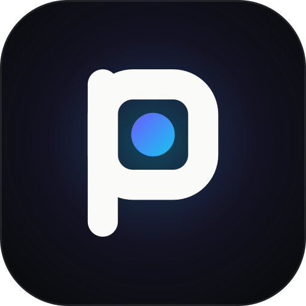

<p align="center">
  <picture>
    <source media="(prefers-color-scheme: dark)" srcset="../../site/public/brand/logo-animated-on-dark.svg">
    
  </picture>
</p>

# PAL brand guide

PAL is the Personal Agentic Layer. Two products share one name and one mark:

- **pal**: the personal agent that lives in your iMessage and WhatsApp. Warm.
- **PAL Runtime**: the runtime pal runs on, for the agents you build. Electric.

Everything here is generated from source in [`build/`](build/), so changing a
colour or a curve means changing it once and re-running the build.

## The mark: Held

 &nbsp;  &nbsp;  &nbsp; 

A p whose bowl holds a dot. The p is the first letter of the name, so the mark
and the wordmark are one drawing. The dot is the moment pal keeps for you, and
the bowl is the layer that holds it until you say yes. पल means "a moment".

PAL Runtime keeps the same p and squares the bowl into a container: same
family, machine register.

Eight directions were explored and scored before choosing this one: open
[`explorations/index.html`](explorations/index.html) in a browser.

### Construction

Monoline, stroke 9, bowl radius 15, round caps, on a 64-unit grid. The dot is
radius 6.5 and sits at the bowl's centre. The wordmark "pal" is drawn, not typed:
single-storey a, and an l with a foot that turns toward the next word. Geometry
lives once in [`build/brand.mjs`](build/brand.mjs) (`MARK`, `WORD`) and is
mirrored by `site/src/components/Logo.astro`.

### Files (`site/public/brand/`)

| File | Use |
|---|---|
| `lockup.svg`, `lockup-on-dark.svg` | primary logo: the wordmark |
| `lockup-horizontal*.svg`, `lockup-stacked*.svg` | wordmark with "Personal Agentic Layer" |
| `mark*.svg` | the p alone, when the name is already on screen |
| `runtime-lockup*.svg`, `runtime-mark*.svg` | PAL Runtime |
| `*-mono-black.svg`, `*-mono-white.svg` | one-colour print, embossing, partner pages |
| `app-icon.svg`, `runtime-app-icon.svg` | rounded-square icons |
| `logo-animated.svg`, `logo-animated-on-dark.svg`, `runtime-logo-animated-on-dark.svg` | hero animation (≈2 KB, CSS only, still under reduced motion) |
| `../favicon.svg`, `../favicon-32.png`, `../apple-touch-icon.png`, `../icon-512.png` | browser and home-screen icons |
| `../og.png` | 1200×630 social card ([source](build/og.html)) |

### Clear space and size

- Clear space on every side: the bowl's diameter (the height of the a).
- Minimum size: wordmark 56 px wide on screen, 14 mm in print; the mark alone 16 px.
- Below 24 px use the mark, not the wordmark.

### Don'ts

- Don't set "pal" in a font. Use the drawn wordmark.
- Don't recolour the strokes with a ramp. Strokes are ink or paper; only the dot carries colour.
- Don't put the warm dot on a Runtime lockup or the electric dot on a pal one.
- Don't outline, shadow, bevel, rotate or stretch the mark.
- Don't place the colour mark on a busy photo; use mono white on a dark scrim.
- Don't animate it beyond the supplied motion (draw, land, one slow ripple).

## Colour

Tokens: [`tokens.css`](tokens.css). Dark is the reference theme; light is
first-class. Ramp colours are for fills, marks and gradients only; text uses
the `*-text` tokens, which pass WCAG AA (4.5:1) on the page background.

| Token | Hex | OKLCH | Role |
|---|---|---|---|
| `--pal-coral` | `#ff7a3d` | `oklch(72.6% 0.178 43.2)` | pal ramp start |
| `--pal-magenta` | `#e5207f` | `oklch(60.8% 0.232 359.1)` | pal ramp end |
| `--rt-indigo` | `#6c5cff` | `oklch(58.6% 0.232 280.9)` | Runtime ramp start |
| `--rt-cyan` | `#14c8f0` | `oklch(77.1% 0.137 219.5)` | Runtime ramp end |
| `--pal-bg` | `#0b0c0f` / `#fafaf8` | `oklch(15.5% 0.007 271)` / `oklch(98.5% 0.003 106)` | ink / paper |
| `--pal-surface` | `#131419` / `#ffffff` | `oklch(19.2% 0.010 276.5)` | cards |
| `--pal-surface-2` | `#1a1c22` / `#f1f0ec` | `oklch(22.7% 0.012 270.8)` | raised cards |
| `--pal-text` | `#fafaf8` / `#0b0c0f` | | body, 18.7:1 |
| `--pal-text-2` | `#b9bac0` / `#45474e` | `oklch(79.0% 0.008 279)` / `oklch(39.9% 0.012 273)` | secondary, 10.1:1 / 8.9:1 |
| `--pal-text-3` | `#8c8e96` / `#62656d` | `oklch(64.8% 0.012 275)` / `oklch(50.7% 0.013 269)` | tertiary, 6.0:1 / 5.6:1 |
| `--pal-accent-text` | `#ff8a6b` / `#c81e5a` | `oklch(75.6% 0.149 35.8)` / `oklch(54.5% 0.202 7.7)` | pal links and highlights, 8.5:1 / 5.3:1 |
| `--rt-accent-text` | `#6fe3ff` / `#4a3ee6` | `oklch(85.9% 0.112 215.8)` / `oklch(49.7% 0.240 276.3)` | Runtime links and highlights, 13.1:1 / 6.4:1 |
| `--sig-ok` | `#5fd3a6` / `#146b4b` | | allowed, sent, verified |
| `--sig-hold` | `#ffb547` / `#a8460a` | | held, waiting for you |
| `--sig-bad` | `#ff8a8a` / `#b42323` | | refused, crashed, blocked |

Gradients run at 135° from the warmer or darker stop. One gradient per view:
on the dot, a button, or a hero glow, never all three.

## Type

| Face | Use |
|---|---|
| Inter Tight (600–700, −0.03em) | headlines |
| Inter (400/500/600) | body and UI |
| JetBrains Mono (400/500) | code, commands, env vars, ports, paths |

Sentence case everywhere. No all-caps labels except the word HELD, which is a
status, not a heading. Diagrams use the system stack because GitHub renders SVG
without web fonts.

## Motion

Motion means something moved through the system.

- A packet is a dot with a soft halo travelling a path at constant speed.
- State changes cross-fade in 300 ms; UI responds in 160 ms.
- Every animation ships its finished frame for `prefers-reduced-motion: reduce`.
- No scroll-triggered entrances, no hover lifts, no confetti.

## Diagrams

Ten animated diagrams live in `site/public/media/` (SVG, 11–15 KB each) with
GIF renders in [`docs/media/pal/`](../media/pal/) for places that can't run SVG.
Each is one CSS-keyframe loop on its own dark stage, so it reads the same on a
light or dark page. The static markup is the poster frame.

| pal | PAL Runtime |
|---|---|
| `pal-brief`: what needs you, ranked | `runtime-architecture`: control plane and your-cloud data plane |
| `pal-holds`: money and promises held for your yes | `runtime-lifecycle`: pause, resume, fork |
| `pal-voice`: scored against your own messages | `runtime-egress`: allowlist, credential injection, DLP |
| `pal-memory`: one person across chats | `runtime-durable`: crash-resume and signed receipts |
| `pal-world`: world model and nudges | `runtime-guardrails`: budgets, routing, eval gates |

Rules: show the real mechanism with real names (ports, endpoints, event kinds),
never boxes labelled "AI". Warm ramp for pal, electric for Runtime, amber for
anything held, red only for refused or crashed. Example people are fictional.

```bash
node docs/brand/build/diagrams.mjs                       # SVGs
NODE_PATH=<scratch>/node_modules node docs/brand/build/render.mjs gif \
  site/public/media/pal-brief.svg docs/media/pal/pal-brief.gif 960 540 13 12 --bg=#0b0c0f
```

`brand.mjs` and `render.mjs` need `opentype.js` and `playwright-core` from a
scratch directory (not repo dependencies), the Inter Tight 500/600 `.woff`
files, system Chrome and `ffmpeg`. The header of each script has the setup.

## Voice

Human, crisp, confident. Say what it does, then stop.

- Write like a friend who is good at their job: "Holds money and promises for your yes."
- Concrete over clever: name the behaviour ("held at the send boundary"), not the category ("AI-powered safety").
- No hype words: revolutionary, seamless, magical, supercharge, unleash, next-generation, game-changing, effortless.
- No exclamation marks in product copy. pal's own messages may use them when the owner does.
- Claims must be true today. If it's behind a flag, say so.

## Naming

| Write | Not |
|---|---|
| pal (lowercase, also at the start of a sentence) | Pal, PAL for the personal agent |
| PAL Runtime | Pal Runtime, PAL runtime, the PAL |
| PAL (the company and the layer) | P.A.L. |
| "your pal", "two agents on PAL Runtime" | PALs, Pals, palz |

Never coin "PAL Pay" or other PAL-plus-noun product names without a trademark
check. The CLI, packages and env vars are spelled `pal` / `PAL_*`; write them
as they are in code.

Taglines: **Your pal for every moment.** · **PAL Runtime: agents that finish,
stay contained, and stay yours.**

## Origin

We started as PAL: a flame you could carry because glass kept it contained.
As the product became a companion, we kept the light and dropped the lamp. The
flame became a dot, a single moment of attention.
